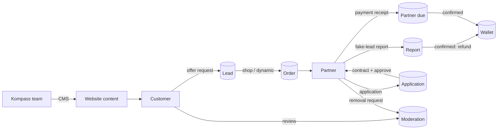

# Kompass — Ecosystem analysis

Kompass (kompassumzug.ch) is a Swiss **lead marketplace for moving and home services**. Customers describe a move once and receive up to five offers. Verified partner companies pay per lead. The Kompass team runs the marketplace and the website content.

Sources analysed:

| App | Legacy stack | Notes |
| --- | --- | --- |
| `kompassFront-main` (public website) | Next.js 15, React 19, next-intl (de/en/fr/it), shadcn/ui, Tailwind 3 | All copy comes from `backend.kompassumzug.ch/api/user/*`. The root layout currently ships only `ComingSoonPage`. |
| `kompassDashboard-main` (admin) | Next.js 14, React 18, Redux Toolkit Query (~20 api slices), TanStack Table, Recharts, Tiptap, Formik/Yup | Translations are de/en and permission strings gate the menu. The package is still named `wagihat`. |
| `company dashboard` | — | Empty in the legacy code. Now built in the prototype as the partner portal (`/portal`). |

## Actors

| Actor | Surface | What they do |
| --- | --- | --- |
| **Customer** | Website | Browse services, companies and guides. Submit an offer request (lead). Leave reviews. Ask FAQ questions. Use the contact form (followed up within 24 hours). |
| **Partner company** | Website → Partner portal | Apply (company, contact, bank, services, account). Sign the contract. Buy leads (shop or dynamic). Upload payment receipts. Report fake leads. Request review removal. |
| **Kompass team** | Admin | Qualify and distribute leads. Approve partners. Reconcile payments. Moderate reviews and follow up on customer requests. Edit every website page in each language. Manage roles. |

## Core flows

1. **Lead.** A 2-step form collects the service, from/to address (ZIP, city, street, rooms, floor, elevator), the date, how many offers (1–5) and the customer's contact details. The legacy fields are in `HomeTypes.OfferForm` and `OfferForm/Form/type.ts`.
2. **Distribution.** A lead becomes an **Order** per partner, either bought in the *shop* (`type "S"`) or assigned *dynamically*. Each lead can be sold until the number of offers the customer asked for is reached.
3. **Fake-lead reports** move through open → testing → pending → confirmed / canceled. Confirming refunds the lead price to the partner wallet.
4. **Finance.** *Partner dues* are uploaded receipts (approve or cancel). *Kompass dues* are what each partner owes: leads purchased minus payments confirmed.
5. **Partner onboarding** moves through pending → contract sent → approved (with a contract expiry date) or rejected. The required documents are the contract, the insurance and the commercial register extract.
6. **Trust.** Reviews of Kompass appear on the homepage. Partner reviews appear on company profiles. Both are moderated. Partners can request removal of a review. (Complaints were removed in October 2026; customers use reviews and the contact form.)
7. **Content.** Every public page is editable: navbar/footer, home, home form, services (body, features, tips), about, blog, FAQs, contact, imprint, companies, partners page, privacy, terms, example offers and the popup ad.

## UX / tech debt found → how the prototype addresses it

| Finding (legacy) | Prototype |
| --- | --- |
| Two divergent stacks and design systems | One app, one token set (`app/globals.css`), one component set (`components/ui`) |
| 15 flat admin menu entries | 8 task-based groups (`components/admin/nav.ts`) |
| Route typos: `fack-offers`, `complains`, `Aplications`, `compnyDital` | Clean routes: `/admin/leads/fake-reports`, `/admin/moderation/partner-reviews` |
| Hardcoded per-column `headers = { en, de }` objects and German strings inside `en.json` | All copy lives in `messages/defs/*` (English) with typed DE/FR/IT translations |
| Wallet column hardcoded to `0 CHF` | Real wallet and ledger (`lib/mock/selectors.ts`) |
| Ban and status toggles fire immediately | Confirm dialogs that explain the consequences (`useConfirm`) |
| 20+ copied DataTable setups and ~20 Formik page forms (some over 20 KB) | One `DataTable` and one schema-driven `SchemaEditor` |
| Empty `messages/*.json` | Full EN, DE, FR and IT for the UI and all CMS content |
| Status colours differ on every page | One `StatusBadge` vocabulary |

## Next phase

- **Partner portal** is now in the prototype (`/portal`). It covers onboarding with contract signing, lead shop by service area, lead outcomes and refunds, wallet with invoices, payouts and a CSV statement, two-way messages with Kompass, a notification bell and to-do list, and a profile with logo, photos, service area and email preferences. See [partner-portal.md](partner-portal.md). Still open: public replies to reviews.
- Replace `lib/mock/api.ts` with real endpoints. Screens call store actions and do not depend on transport.
