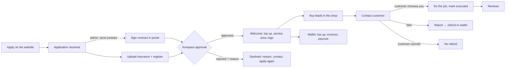

# Partner portal — flows and screens

The partner portal (`/portal`) is where a moving or cleaning company applies, buys leads, serves customers and manages its money with Kompass. This note explains every partner flow, the screens and the states each one handles, and how the admin and the website feed into it. Read it with [ecosystem.md](ecosystem.md).

**Design principle:** every action that admin or a customer takes about a company appears in the portal as a **status** (on the thing it changed), a **to-do** (when the company has to act) or a **notification** (in the bell and on the Overview). A company should never need an email to find out what happened.

## Partner journey

## Screens

| Screen | Route | What the company does | States it handles |
| --- | --- | --- | --- |
| Sign in | `/portal/login` | Picks a company. The prototype lists **Partners** and **Applications** separately. `?as=<id>` preselects one (from the website's "Track your application"). | Approved → portal. Any other status → onboarding. |
| Onboarding | `/portal/onboarding` | Follows four steps: application received → sign the contract → upload insurance and register extract → Kompass approval. | **Pending:** contract not sent yet. **Contract sent:** the contract can be read and signed (scroll to the end, tick, type your name). **Signed + documents:** waiting for Kompass. **Rejected:** the reason, contact Kompass, apply again. **Approved:** welcome and three first steps. |
| Overview | `/portal` | Sees what needs attention. | **To do** (most urgent first, one action each): documents blocking purchases, overdue or soon-due invoices, customers who booked you, urgent leads Kompass assigned, unread messages, wallet below one lead price. "All caught up" when empty. Also: recent activity (`#activity`), messages, recent purchases with their outcome, six-month spending chart. |
| Notification bell | top bar | Sees what changed. Opening the bell marks items read. | Built from the data (`partnerFeed`), not stored: document accepted / rejected / expiring / expired; receipt confirmed / rejected; Kompass top-up; credit given; invoice overdue; refund / refund declined; lead assigned; lead cancelled (fake / customer); customer chose you; new message; payout paid / declined; new review; removal decided. |
| Lead shop | `/portal/shop` | Buys leads. | Starts on **My area** (the cantons from the profile) when it has leads, otherwise all cantons. Empty area → "show all N leads". Documents blocking → a link to the Documents tab. |
| My leads | `/portal/leads` | Contacts customers, marks jobs done, reports fakes. | One **outcome** per lead: Open · Booked you · Chose another company · Executed · Reported as fake · Fake, refunded · Cancelled by customer. "Assigned by Kompass" badge, with the agreed price and admin's note. "Customer notified on …". Fake-report progress (open → testing → pending → confirmed / not confirmed). Fake refunded: amount and date, with a link to the statement. Cancelled by the customer: no refund, and why. "Mark executed" asks for confirmation. |
| Wallet & invoices | `/portal/payments` | Tops up, pays invoices, requests payouts, exports the statement. | **Overview:** balance, available for payout, pending receipts, credit to repay. **Invoices:** pay by card / TWINT (paid at once) or bank transfer (IBAN plus the invoice number as reference), or print / save as PDF. **Payouts:** request up to the available amount (balance − payouts already requested − unpaid credit, minimum CHF 50) to the IBAN on file. "Wrong IBAN?" opens a message. **Statement:** filter by type and period, export as CSV. An overdue invoice shows a banner. `?tab=` deep links. |
| Messages | `/portal/messages` | Talks to Kompass. | Conversations grouped by thread, with topics: General, Billing, Leads, Documents, Profile change. Unread dots, "Seen" / "Sent" on own messages. A new message opens with a topic picker. Profile changes, IBAN changes, suspension questions and application questions all start a thread here. On mobile, the list and the thread take turns. |
| Reviews | `/portal/reviews` | Unchanged: reads reviews, requests removal. | The bell reports new reviews and removal decisions. |
| Company profile | `/portal/profile` | Keeps its data current. | **Company:** read-only except phone; "Request a change" opens a profile thread. **Documents:** upload or replace. **Logo & photos:** logo plus up to 8 photos, scaled down in the browser; items admin added are marked "Added by Kompass". **Service area:** cantons (shop filter), plus where Kompass recommends the company and at what rank. **Notifications:** email preferences. `?tab=` deep links. |

## Admin action → what the company sees

| Admin / customer action | Where the company sees it |
| --- | --- |
| Send contract (Applications) | Onboarding step 2 becomes "Your turn" with the contract. |
| Approve / reject application (reason required) | Welcome screen / declined screen with the reason. |
| Accept / reject a document, expiry near | Bell, To do, status banner, Documents tab. |
| Confirm / reject a payment receipt | Bell, receipt status, statement. |
| Top up, give credit (invoice) | Bell, statement, Invoices tab, To do when due. |
| Mark invoice paid | Invoice status. |
| Assign a lead manually (price + note) | Bell, To do, "Assigned by Kompass" badge and note on the lead. |
| Cancel offer as fake / by customer | Bell, lead outcome banner (refunded / not refunded). |
| Confirm / reject fake-lead report | Lead report progress, refund in the statement. |
| Customer chooses a company | Bell, To do ("booked you"), lead outcome. |
| Message the company / reply | Bell, Messages, Overview. |
| Pay / reject a payout (Finance › Payouts) | Bell, Payouts tab, statement. |
| Nominate for a region (Recommendations) | Profile › Service area › "Recommended by Kompass". |
| Upload logo / photos (Files) | Profile › Logo & photos ("Added by Kompass"), public profile. |
| Approve review / removal request | Bell. |

## What changed in admin and on the website

- **Admin › Partners › Applications:** cards show "Signed" and the document count. Approving warns about a missing signature or missing documents. Rejecting needs a reason, which the applicant sees.
- **Admin › Finance › Payouts (new):** requested / paid / rejected. Pay asks for the bank reference and takes the amount from the wallet; reject asks for a reason. The nav badge counts requests.
- **Admin › company page:** Messages is now a two-way thread view with reply. A Payouts block sits in the Wallet tab. `?tab=` deep links (notifications point there).
- **Website:** company pages show the logo and photos. "Verified" is shown only while the documents are valid. Newly approved companies have a public page. Registering links to "Track your application".

## Out of scope (decided 22 Oct 2026)

- The no-show response flow (the company writes its explanation) and public replies to reviews.
- Real authentication, real email sending and real payment providers. Everything is simulated through `lib/mock`.
